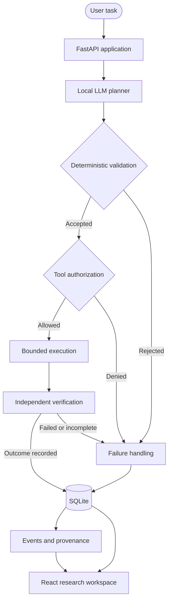

# ◈ ATLAS-X

### Make AI agents accountable.

**A local-first research platform for controlled execution, independent verification, provenance, and reproducible experimentation.**

<p align="center">
  <strong>LOCAL-FIRST AI · SECURITY ENGINEERING · VERIFIABLE EXECUTION · REPRODUCIBLE RESEARCH</strong>
</p>

<p align="center">
  [Python](https://www.python.org/) · [FastAPI](https://fastapi.tiangolo.com/) · [React](https://react.dev/) · [TypeScript](https://www.typescriptlang.org/) · [Ollama](https://ollama.com/) · [MIT License](LICENSE)
</p>

> **Plans aren't permissions. Execution isn't proof. Provenance isn't a signature.**

[Explore the architecture](docs/architecture/) · [Security model](SECURITY.md) · [Known limitations](docs/KNOWN_LIMITATIONS.md)

---

## 🧭 Why ATLAS-X?

An AI agent can generate a plausible plan, request a tool, fail halfway through execution, and still describe the task as completed.

A confident answer is not evidence. A prompt is not an authorization boundary. And a green status indicator is not a security certification.

**ATLAS-X investigates how AI-agent workflows can become more constrained, inspectable, and verifiable.**

It combines local-model planning with application-controlled validation, tool authorization, bounded execution, outcome verification, persistent state, and provenance records.

The goal isn't to pretend that an LLM is perfectly reliable. It's to engineer the system around the ways it can fail.

## ✨ Inside the research workspace

### 01 · The dashboard

A central workspace for navigating tasks, the research playground, benchmarks, security, and provenance.


### 02 · Create a research task

Define a research goal and inspect the available tools before execution.


### 03 · Explore tools

Inspect a selected tool's description and input parameters in the research playground.


### 04 · Run and inspect experiments

Explore scenarios, ablation configurations, and experiment history. The values shown are a development snapshot, not a validated performance comparison.


### 05 · Investigate security state

Explore task status, permissions, provenance, integrity, and security-related workflows.


### 06 · Verify provenance

Inspect the interface's chain-verification result and associated task information. This demonstrates an integrity-check workflow, not a guarantee that the whole application is secure.


---

## 🧠 How it works



<sub>Conceptual architecture. Actual guarantees depend on the implemented component, tool, and runtime configuration.</sub>

### The execution lifecycle

| Stage | Responsibility |
|---|---|
| **Plan** | A local language model proposes a structured task plan. |
| **Validate** | Application logic checks the plan against expected structure and constraints. |
| **Authorize** | Tool access is evaluated against application-defined rules. |
| **Execute** | Approved operations run through the configured execution controls. |
| **Verify** | The outcome is assessed separately from the model's claim of success. |
| **Record** | Task state, events, metrics, and provenance-related data are persisted. |
| **Recover** | Selected failure paths and bounded recovery logic handle unsuccessful or incomplete operations. |

The central design choice is separating **model-generated intent** from **application-enforced control**. That reduces reliance on the model to police its own behavior, without pretending to eliminate every implementation bug or attack path.

---

## 🔬 Engineering principles

<details>
<summary><strong>🛡️ Controlled tool execution</strong></summary>

- Tool registry and controlled dispatch.
- Schema validation and authorization checks.
- Task ownership controls.
- Bounded execution and selected failure-handling paths.
- Sandboxing-oriented execution controls.

The current Windows/WSL2 and subprocess approach is not equivalent to hardened container isolation.

</details>

<details>
<summary><strong>✅ Independent verification</strong></summary>

Task execution and assessment of its outcome are treated as separate concerns. The useful question isn't simply whether the model said it worked, but what evidence was recorded and whether the result satisfied the relevant checks.

Verification guarantees depend on the verifier and task type.

</details>

<details>
<summary><strong>🔗 Provenance and integrity</strong></summary>

- Structured execution and event records.
- Hash-linked provenance-related data.
- Integrity verification workflows.
- Task-level inspection of provenance and events.
- SQLite-backed local persistence.

Hash-linked records can help detect certain changes. A digest alone is not a digital signature, proof of authorship, or independently trusted attestation.

</details>

<details>
<summary><strong>🧪 Reproducible experimentation</strong></summary>

The benchmark framework organizes scenarios, baseline configurations, ablation modes, and metrics.

Research areas include security, multi-step execution, verification, provenance, and recovery.

A benchmark interface is not itself evidence of superior performance. Meaningful comparisons require a documented protocol, appropriate baselines, repeatable runs, configuration details, and measured results.

</details>

<details>
<summary><strong>💻 Local-first development</strong></summary>

Ollama provides local-model integration, while SQLite supports local persistence. Core local-model workflows are designed to avoid mandatory paid hosted inference APIs.

Model downloads, hardware requirements, and model licensing still apply.

</details>

---

## 🧰 Technology stack

| Layer | Technologies |
|---|---|
| Backend | Python · FastAPI · Pydantic |
| Local inference | Ollama · locally hosted language models |
| Frontend | React · TypeScript · Vite |
| Persistence | SQLite |
| Execution controls | Windows · WSL2 · subprocess-based controls |
| Python quality | pytest · Ruff · mypy |
| Frontend quality | Playwright · ESLint · production build |
| Automation | GitHub Actions |

---

## 🚀 Run ATLAS-X locally

ATLAS-X is a research and development project. Follow the current repository configuration and deployment guide if a command differs from your checkout.

### Prerequisites

- Windows with PowerShell.
- Python 3.11, subject to the project's declared compatibility.
- Node.js and npm compatible with the frontend lockfile.
- Git.
- Ollama and a compatible local model.
- WSL2 for workflows that use the configured WSL2 execution environment.

### 1. Clone the repository

```powershell
git clone https://github.com/n0tify/ATLAS-X.git
cd ATLAS-X
```

### 2. Create a Python environment

```powershell
py -3.11 -m venv .venv
.\.venv\Scripts\Activate.ps1
python -m pip install --upgrade pip
python -m pip install -e .
```

If editable installation is not configured in the current checkout, follow the dependency installation instructions in `pyproject.toml` and the development guide.

### 3. Configure the environment

Use the provided `.env.example` files as templates. Supply the required settings and generate appropriate local secrets.

- Never commit actual credentials, tokens, or production secrets.
- Do not reuse example values as production credentials.
- Review `SECURITY.md` before exposing any service beyond your machine.

### 4. Install frontend dependencies

```powershell
cd frontend
npm ci
cd ..
```

### 5. Prepare the local model

Install [Ollama](https://ollama.com/). The reported development setup used `llama3.1:8b`; use the model expected by the current configuration.

```powershell
ollama pull llama3.1:8b
ollama list
```

Model availability, hardware requirements, and license terms depend on the selected model.

### 6. Start the application

The repository includes a PowerShell startup script:

```powershell
.\start_atlas.ps1
```

Review the script and `docs/DEPLOYMENT_GUIDE.md` for supported options and any separate backend/frontend startup requirements. Confirm the API, frontend, and model service are healthy before testing a workflow.

---

## 🧪 Quality engineering

### Backend

```powershell
python -m ruff check .
python -m mypy atlas
python -m pytest -q
```

Some live-planning tests may require Ollama and the configured model.

### Frontend

```powershell
cd frontend
npm run lint
npm run build
npx playwright install
npx playwright test
```

| Check | Purpose |
|---|---|
| Ruff | Python linting |
| mypy | Static type analysis |
| pytest | Python unit and integration tests |
| ESLint | Frontend linting |
| Vite build | Frontend production compilation |
| Playwright | Browser workflow tests |

**Previously reported verification:** Ruff passed, mypy reported no issues across 86 source files, and staged/unstaged Git whitespace checks passed. Earlier development reports recorded 737 backend tests and 21 Playwright tests passing, but those counts were not rerun during the latest release-preparation pass. Treat them as historical reports, not freshly reproduced release results.

Passing tests are useful evidence, not proof of security or correctness for every workload.

---

## 🔐 Security model and limitations

Security claims should be proportional to the evidence. ATLAS-X includes security-oriented controls, but it is not presented as a security-certified or production-hardened multi-tenant service.

| Area | Current position |
|---|---|
| Authentication and authorization | Application controls are implemented and have associated tests. |
| Plan and tool validation | Deterministic validation and authorization boundaries are used. |
| Execution isolation | WSL2/subprocess controls; not hardened container isolation. |
| Browser token storage | `localStorage` creates exposure risk if an XSS vulnerability occurs. |
| Provenance | Integrity-related digests; not signed attestations. |
| Account protection | MFA and account recovery are incomplete. |
| Remote deployment | TLS, reverse-proxy configuration, and remote operations remain unverified. |

Before using ATLAS-X with untrusted workloads, review [`SECURITY.md`](SECURITY.md), [`docs/KNOWN_LIMITATIONS.md`](docs/KNOWN_LIMITATIONS.md), and the architecture documentation.

A development instance should not be exposed directly to the public internet merely because the interface loads.

---

## 🧭 Research directions

ATLAS-X supports investigation of questions such as:

1. **Authorization:** How effectively can application-defined policies constrain model-proposed tool use?
2. **Verification:** Which task-specific checks distinguish completed operations from plausible completion claims?
3. **Provenance:** What records are necessary to investigate an execution and reproduce its relevant conditions?
4. **Recovery:** How do bounded recovery strategies affect outcomes under controlled failure conditions?
5. **Ablation:** What changes when individual controls are disabled in a controlled experimental setup?
6. **Reproducibility:** How can scenarios, configurations, software versions, and model settings be recorded consistently?

The next research step is rigorous evaluation: explicit hypotheses, repeatable configurations, meaningful baselines, measured outcomes, and clear limitations.

---

## 🗺️ Repository structure

```text
ATLAS-X/
├── .github/workflows/      # CI automation
├── api/                    # FastAPI application and routers
├── atlas/                  # Core agent, security, storage and execution modules
├── benchmarks/
│   └── atlas_bench/        # Experiment and benchmark framework
├── datasets/               # Dataset definitions
├── docs/
│   ├── architecture/       # Architecture and trade-offs
│   ├── development/        # Development and research guidance
│   └── assets/             # README screenshots
├── frontend/
│   ├── src/                # React and TypeScript application
│   └── tests/              # Browser and acceptance tests
├── scripts/                # Development utilities
├── tests/                  # Python test suite
├── CONTRIBUTING.md
├── LICENSE
├── README.md
├── SECURITY.md
└── pyproject.toml
```

Generated databases, local environments, browser state, logs, caches, temporary scripts, and private credentials should remain outside the public source release.

---

## 🛣️ Roadmap

- [ ] Harden execution isolation and validate trust boundaries.
- [ ] Improve browser authentication and account-security controls.
- [ ] Explore signed provenance attestations.
- [ ] Expand controlled fault-injection and recovery experiments.
- [ ] Publish reproducible benchmark protocols and measured results.
- [ ] Extend automated dependency and security checks.
- [ ] Validate remote deployment, TLS, reverse-proxy configuration, and operational monitoring.

Roadmap items describe future work, not completed functionality.

## 🤝 Contributing

Contributions focused on security, reliability, reproducibility, testing, and developer experience are welcome.

1. Read [`CONTRIBUTING.md`](CONTRIBUTING.md).
2. Review the architecture and known limitations.
3. Make a focused, testable change.
4. Add or update tests where appropriate.
5. Run the relevant quality checks.
6. Document changes affecting security boundaries, execution behavior, or reproducibility.

Do not submit credentials, private data, generated local databases, or unreviewed execution artifacts.

## 📄 License

The original ATLAS-X project code is distributed under the [MIT License](LICENSE).

Third-party dependencies, assets, and model weights may be subject to separate licenses and terms. The project's license does not override those obligations.

---

<div align="center">

### ATLAS-X

**From model-generated plans to controlled, inspectable execution.**

*Build systems that can explain not just what they intended to do, but what the evidence says happened.*

</div>
