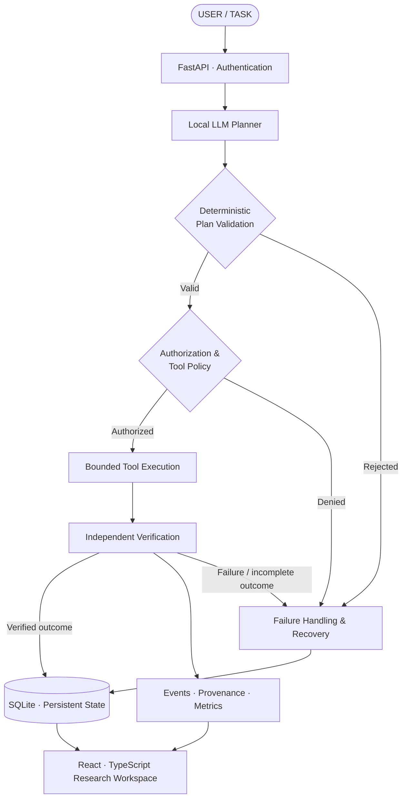

# ATLAS-X
### Engineering AI Agents You Can Inspect, Constrain, and Verify.

<p align="center">
  <strong>LOCAL-FIRST AI · CONTROLLED EXECUTION · SECURITY ENGINEERING · REPRODUCIBLE RESEARCH</strong>
</p>

<p align="center">
  <em>What happens when an AI agent's plan is treated as a proposal, its tools as privileged capabilities, and its success as something that must be verified?</em>
</p>

<p align="center">
  <a href="https://github.com/n0tify/ATLAS-X">Repository</a> ·
  <a href="https://github.com/n0tify/ATLAS-X/tree/main/docs/architecture">Architecture</a> ·
  <a href="https://github.com/n0tify/ATLAS-X/blob/main/SECURITY.md">Security</a> ·
  <a href="https://github.com/n0tify/ATLAS-X/blob/main/docs/KNOWN_LIMITATIONS.md">Limitations</a>
</p>

---

## THE PROBLEM

**An AI agent saying it completed a task is not evidence that it did.**

A model can generate an invalid plan, request an unauthorized action, fail during execution, or report success despite an incorrect outcome. When planning, permissions, execution, and verification are blurred together, these failures become difficult to detect and even harder to investigate.

ATLAS-X explores a different approach.

It is a **local-first AI agent research platform** built around a simple principle:

> **Intelligence proposes. Deterministic controls authorize. Execution produces evidence. Verification determines success.**

Instead of treating an LLM as an autonomous authority, ATLAS-X places it inside a controlled execution pipeline designed to make agent behavior more inspectable, constrained, and reproducible.

## SYSTEM OVERVIEW



<sub>Conceptual architecture. Exact control flow and guarantees depend on the implemented component and runtime configuration.</sub>

---

## ENGINEERING PRINCIPLES

<table>
<tr>
<td width="50%" valign="top">

### 01 / Control over compliance

**A prompt is not a security boundary.**

Plans and tool arguments pass through application-defined validation and authorization rather than relying on the model to obey instructions.

</td>
<td width="50%" valign="top">

### 02 / Verification over assertion

**Execution is not the same as success.**

Task outcomes are evaluated separately from the model's description of what happened.

</td>
</tr>
<tr>
<td width="50%" valign="top">

### 03 / Local-first by design

**Inference and research without mandatory paid APIs.**

Ollama provides the local-model integration, while SQLite supports local application state and experiment records.

</td>
<td width="50%" valign="top">

### 04 / Evidence over intuition

**Make experiments inspectable and repeatable.**

Structured configurations, execution records, metrics, and provenance support debugging and controlled evaluation.

</td>
</tr>
</table>

---

## WHAT'S INSIDE

<details open>
<summary><strong>01 · Agent planning and orchestration</strong></summary>

- Local language-model integration through Ollama.
- Structured task planning.
- Deterministic validation before tool execution.
- Explicit handling of rejected plans and execution failures.
- Bounded recovery workflows.

The model contributes reasoning and proposed actions. The surrounding application remains responsible for enforcing its execution rules.

</details>

<details>
<summary><strong>02 · Tool execution and security boundaries</strong></summary>

- Tool registry and controlled dispatch.
- Schema validation and authorization checks.
- Authentication and owner-scoped task access.
- Sandboxing-oriented execution controls.
- Fail-closed handling for selected production-sensitive configuration.
- Security-related response headers and automated tests.

The current Windows/WSL2 and subprocess execution model is not equivalent to hardened isolation against a determined attacker.

</details>

<details>
<summary><strong>03 · Verification, persistence and provenance</strong></summary>

- Persistent task and execution state.
- SQLite-first structured storage.
- Structured event and evaluation records.
- Provenance metadata and integrity-related digests.
- Verification-oriented task outcomes.
- Local research and inspection workflows.

Provenance makes execution easier to inspect; a digest alone does not establish authenticity or provide a cryptographic signature.

</details>

<details>
<summary><strong>04 · Benchmarking and experimentation</strong></summary>

The research framework organizes experiments around scenarios, baselines, configurations, and evaluation metrics.

Its areas of investigation include:

- Tool authorization and security.
- Multi-step task execution.
- Independent verification.
- Provenance tracking.
- Failure handling and recovery.
- Ablation studies and baseline comparisons.

These are research capabilities, not claims of demonstrated superiority. Quantitative performance claims require reproducible experiments and published results.

</details>

<details>
<summary><strong>05 · Research workspace</strong></summary>

A React and TypeScript frontend connects to a FastAPI backend to support workflows around:

- Authentication and task management.
- Task execution and inspection.
- Tool visibility.
- Security and provenance exploration.
- Benchmark and experiment workflows.

</details>

---

## TECHNOLOGY STACK

| Layer | Technologies |
|---|---|
| Application backend | Python · FastAPI · Pydantic |
| AI inference | Ollama · Locally hosted language models |
| Frontend | React · TypeScript · Vite |
| Persistence | SQLite · Structured event/evaluation records |
| Execution | Windows · WSL2 · Subprocess controls |
| Testing | pytest · Playwright |
| Code quality | Ruff · mypy · ESLint |
| Automation | GitHub Actions |

The project prioritizes local development, explicit control boundaries, bounded resource use, and tools that can be used without mandatory paid inference services.

---

## GETTING STARTED

### Prerequisites

- Windows with PowerShell.
- Python 3.11, subject to the project's declared compatibility.
- Node.js and npm compatible with the frontend configuration.
- Git.
- Ollama and a compatible local model for model-backed workflows.
- WSL2 for workflows that use the configured WSL2 execution environment.

### 1. Clone the repository

```powershell
git clone https://github.com/n0tify/ATLAS-X.git
cd ATLAS-X
```

### 2. Set up Python

```powershell
py -3.11 -m venv .venv
.\.venv\Scripts\Activate.ps1
python -m pip install --upgrade pip
python -m pip install -e .
```

If the repository's current dependency configuration specifies a different development installation command, follow that configuration.

### 3. Configure the environment

Start from the available `.env.example` files and configure the required settings for your local environment.

Never commit actual credentials or production secrets. Generate appropriate local secrets and consult the deployment documentation for the required configuration.

### 4. Install frontend dependencies

```powershell
cd frontend
npm ci
cd ..
```

### 5. Set up the local model

Install Ollama from [ollama.com](https://ollama.com/), then obtain the model expected by the current project configuration.

For the reported development setup:

```powershell
ollama pull llama3.1:8b
ollama list
```

Model availability, hardware requirements, and licensing depend on the selected model.

### 6. Launch ATLAS-X

The repository includes a PowerShell startup script:

```powershell
.\start_atlas.ps1
```

Consult the current deployment and development documentation if your environment requires separate backend and frontend startup. Confirm the script's supported options in the checked-out version.

---

## QUALITY ENGINEERING

ATLAS-X uses automated checks at several levels.

### Backend

```powershell
python -m ruff check .
python -m mypy atlas
python -m pytest -q
```

### Frontend

```powershell
cd frontend
npm run lint
npm run build
npx playwright install
npx playwright test
```

Run commands from the appropriate project directory and ensure environment-dependent services are available.

| Verification layer | Purpose |
|---|---|
| Ruff | Python linting |
| mypy | Static type analysis |
| pytest | Python unit and integration tests |
| ESLint | Frontend linting |
| Vite build | Frontend production compilation |
| Playwright | Browser-level workflow testing |

**Verification status:** The latest reported development checks passed Ruff, mypy across 86 source files, and staged/unstaged Git whitespace checks. Earlier reports recorded 737 backend tests and 21 Playwright tests passing, but those test counts were not rerun during the latest release-preparation pass. They are not presented as a freshly verified release result.

Passing tests is useful evidence, not a proof of security or production readiness.

---

## SECURITY MODEL & LIMITATIONS

Security is part of the architecture, but the trust boundary must be described honestly.

| Area | Current position |
|---|---|
| Authentication and authorization | Implemented application controls with tests |
| Plan and tool validation | Deterministic validation and authorization boundaries |
| Execution isolation | WSL2/subprocess controls; not hardened container isolation |
| Browser authentication | `localStorage` token storage presents an XSS exposure risk |
| Provenance | Integrity-related digests; not signed attestations |
| Account protection | MFA and account recovery are incomplete |
| Production operations | Remote deployment and TLS/reverse-proxy configuration remain unverified |

ATLAS-X should be treated as a **research and development platform**, not a security-certified service or a production-hardened multi-tenant agent runtime.

Before exposing it to untrusted workloads, review [`SECURITY.md`](SECURITY.md) and [`docs/KNOWN_LIMITATIONS.md`](docs/KNOWN_LIMITATIONS.md).

Security reports should follow the private reporting guidance in `SECURITY.md`, where configured.

---

## RESEARCH DIRECTIONS

The most interesting question is not whether an agent can complete a demonstration. It is whether the system can establish what happened, why it was permitted, and whether the outcome satisfies its requirements.

ATLAS-X provides a foundation for investigating questions such as:

- How effectively can deterministic policy checks constrain model-proposed actions?
- How can verification distinguish actual task completion from a plausible textual claim?
- Which provenance records are necessary to reproduce and investigate an execution?
- How do recovery strategies affect reliability under controlled failure conditions?
- What trade-offs emerge between model flexibility, execution constraints, and verifiability?

The next step for this research is controlled evaluation: explicit hypotheses, reproducible configurations, documented baselines, and measured results.

---

## PROJECT STRUCTURE

```text
ATLAS-X/
├── .github/workflows/     # CI automation
├── api/                   # FastAPI application and routers
├── atlas/                 # Core agent and execution modules
├── benchmarks/
│   └── atlas_bench/       # Experiment and benchmark framework
├── datasets/              # Dataset definitions
├── docs/
│   ├── architecture/      # System architecture and trade-offs
│   └── development/       # Development and research guidance
├── frontend/
│   ├── src/               # React and TypeScript workspace
│   └── tests/             # Browser and acceptance tests
├── scripts/               # Development utilities
├── tests/                 # Python test suite
├── .env.example
├── CONTRIBUTING.md
├── LICENSE
├── README.md
├── SECURITY.md
└── pyproject.toml
```

Generated databases, credentials, browser state, local environments, logs, caches, and temporary scripts are intentionally excluded from the public source release.

---

## ROADMAP

- [ ] Harden execution isolation and validate the threat boundary.
- [ ] Improve browser authentication and account-security controls.
- [ ] Explore signed provenance attestations.
- [ ] Expand controlled fault-injection and recovery experiments.
- [ ] Publish reproducible benchmark protocols and measured results.
- [ ] Extend automated dependency and security checks.
- [ ] Validate remote deployment, TLS, reverse-proxy configuration, and operational monitoring.

This roadmap describes potential future work, not completed functionality.

---

## CONTRIBUTING

Contributions to security, reliability, reproducibility, and developer experience are welcome.

1. Read [`CONTRIBUTING.md`](CONTRIBUTING.md).
2. Understand the architecture and documented limitations.
3. Make a focused, testable change.
4. Add or update tests where appropriate.
5. Run relevant quality checks.
6. Document changes that affect security boundaries or execution behavior.

Do not submit credentials, private data, generated local databases, or unreviewed execution artifacts.

---

## LICENSE

ATLAS-X's original project code is distributed under the [MIT License](LICENSE).

Third-party dependencies, assets, and model weights may be governed by separate licenses and terms. The project's license does not supersede those obligations.

---

<p align="center">
  <strong>ATLAS-X</strong>
  <br/>
  <em>From model-generated plans to controlled, inspectable execution.</em>
  <br/><br/>
  <sub>Built around a simple idea: an intelligent system should be evaluated by what it can demonstrate, not merely what it can claim.</sub>
</p>
