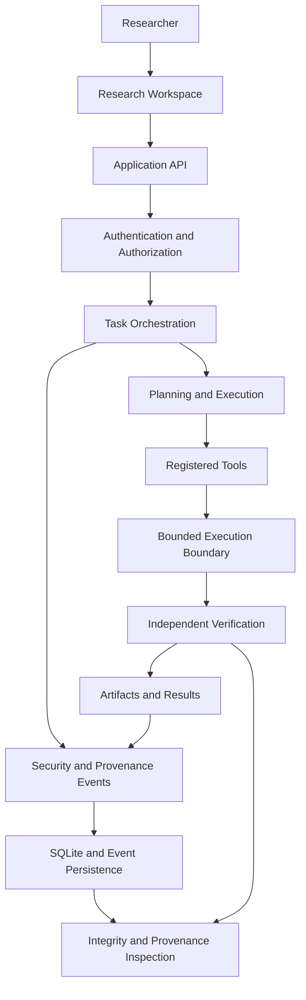

# ATLAS-X
### A Local-First Research Platform for Reliable AI Agents

<p align="center">
  <strong>Investigating reliability, authorization, sandboxing, independent verification, and provenance in multi-step AI agent systems.</strong>
</p>

<p align="center">
  <a href="https://github.com/n0tify/ATLAS-X">Repository</a> ·
  <a href="https://github.com/n0tify/ATLAS-X/issues">Issues</a> ·
  <a href="https://github.com/n0tify/ATLAS-X/security">Security</a>
</p>

---

## Overview

AI agents can plan, select tools, execute actions, and produce artifacts. But a successful-looking output does not necessarily mean that an agent followed its permissions, executed safely, or produced results that can be independently verified.

**ATLAS-X is a local-first research prototype for investigating these reliability and security properties.**

It brings task orchestration, tool execution, verification, provenance tracking, security inspection, and controlled experiments into a single research workspace. The goal is to make agent behavior easier to inspect, evaluate, reproduce, and debug.

Rather than treating an agent's final response as the only measure of success, ATLAS-X provides infrastructure for examining the process that produced it.

### Research questions

- How can tool permissions be enforced throughout a multi-step task?
- How should tool execution be bounded and isolated?
- Can independent verification detect failures that ordinary execution reports miss?
- How can event histories and artifact digests support provenance inspection?
- How do individual reliability and security controls affect experimental outcomes?
- How can experiments remain reproducible without depending on paid APIs or remote inference services?

> **Project status:** Research prototype. The interface and supporting research infrastructure are implemented, but not every security property is guaranteed, and the benchmark framework should not be interpreted as proof of production-grade reliability.

## Key capabilities

| Capability | Purpose |
|---|---|
| Task orchestration | Represent research goals as structured tasks and execution steps. |
| Tool registry | Discover available tools and inspect their capabilities. |
| Authorization | Apply permission checks to tool operations. |
| Bounded execution | Constrain supported execution paths and investigate isolation boundaries. |
| Independent verification | Check execution outcomes against verification rules. |
| Provenance tracking | Record security-relevant events and inspect hash-linked histories. |
| Artifact inspection | Examine artifact metadata, checksums, and related task information. |
| Security workspace | Inspect task permissions, provenance, integrity, and events. |
| Benchmark experiments | Run supported scenarios and compare configured experimental conditions. |
| Local-first operation | Keep the research workflow centered on local infrastructure and data. |

Actual guarantees depend on the execution path, configuration, and implementation. See [Security and limitations](#security-and-limitations).

## Interface tour

The screenshots below illustrate the research workspace. Add the corresponding image files under `docs/assets/` using the filenames shown here.

### 1. Authentication

A dedicated sign-in interface for accessing the research workspace.


### 2. Research dashboard

The dashboard presents the research environment and a lifecycle visualization covering task creation, planning, authorization, tool execution, sandboxing, verification, artifacts, and provenance.


### 3. Create a research task

Define a task title and research goal, then inspect the tools available to the workspace.


### 4. Research Playground

Browse registered tools, inspect tool metadata and input parameters, and interact with supported analysis operations.


### 5. Research benchmarks

Explore supported scenarios, select experimental configurations, and inspect recorded experiment history.


Benchmark availability and recorded experiment counts are not, by themselves, evidence of improved agent performance. Interpret results using the corresponding methodology and limitations.

### 6. Security Center

Inspect task-level information, permission views, provenance, integrity checks, and security-relevant events.


### 7. Provenance Explorer

Browse recorded task events and examine their associated chain digests.


### 8. Integrity verification

Inspect the reported outcome of a provenance-chain integrity check.


**Screenshot setup:** Save the nine supplied screenshots using the filenames above. Keep the images genuine and unaltered except for cropping or redacting sensitive information. In particular, remove email addresses, tokens, private task data, and other account information before publishing.

## Architecture

ATLAS-X follows a local-first architecture built around explicit task state, controlled tool execution, persistence, verification, and provenance.



The diagram is a conceptual overview rather than a complete deployment or trust-boundary specification. Consult the architecture and threat-model documents for implementation details.

### Technology stack

| Layer | Technologies |
|---|---|
| Backend | Python, FastAPI, Pydantic |
| Persistence | SQLite and structured event records |
| Authentication | Argon2-based password hashing and token-based authentication |
| Frontend | React, TypeScript, Vite |
| Local inference | Ollama, when configured |
| Testing and quality | pytest, Ruff, mypy, ESLint, Playwright |
| Execution environment | Windows development environment; WSL2 for supported isolated execution paths |

Versions and configuration requirements should be taken from the repository's dependency and environment files.

## Research methodology

ATLAS-X is designed to support controlled investigations into agent reliability rather than to assume that an agent's own reports are sufficient evidence.

### Verification

Verification checks execution outcomes using explicit rules. It is intended to provide a separate assessment of task results instead of relying solely on the agent's final response.

### Provenance and integrity

The provenance workspace records events and exposes hash-linked event sequences for inspection. Integrity verification can detect certain inconsistencies in the recorded chain.

**Important:** A valid hash chain does not establish that the original events were truthful, that the host was uncompromised, or that an attacker could not rewrite the entire history. Hash-linked provenance is not equivalent to a digitally signed, externally anchored audit log.

### Experimental comparisons

The benchmark workspace supports scenario selection, configuration selection, ablation modes, and experiment-history inspection.

When interpreting results:

- Distinguish measured outcomes from simulated or controlled-harness behavior.
- Record the scenario, configuration, execution conditions, and relevant artifacts.
- Compare equivalent conditions before attributing an outcome to a particular security control.
- Report failures, unavailable configurations, and missing observations.
- Do not claim statistical significance or generalization without suitable experimental evidence.

Some benchmark infrastructure may use controlled harness doubles or simulated baselines. These are useful for testing experimental plumbing, but they are not substitutes for measurements of real-world agent performance.

## Getting started

ATLAS-X is intended to be run locally. The instructions below reflect the documented development workflow; verify environment-specific requirements against the current repository before running it.

### Prerequisites

- Git
- Python 3.11
- Node.js and npm compatible with the frontend dependencies
- A supported Windows or Linux development environment
- WSL2 with Ubuntu 24.04 for execution paths that require it
- Ollama and a compatible local model, if using local model inference

### 1. Clone the repository

```bash
git clone https://github.com/n0tify/ATLAS-X.git
cd ATLAS-X
```

### 2. Set up the Python environment

Create and activate a virtual environment.

**Windows PowerShell**

```powershell
py -3.11 -m venv .venv
.\.venv\Scripts\Activate.ps1
python -m pip install --upgrade pip
pip install -e ".[dev]"
```

**Linux**

```bash
python3.11 -m venv .venv
source .venv/bin/activate
python -m pip install --upgrade pip
pip install -e ".[dev]"
```

If editable installation fails, check the development dependencies and package configuration in `pyproject.toml`.

### 3. Configure environment variables

Start from the repository's `.env.example` and follow the variable names and instructions defined by the current configuration.

Do not commit populated environment files, credentials, authentication tokens, private datasets, or local databases.

Use unique development credentials and keep secrets out of source control. Do not expose a development server directly to the public internet.

### 4. Start the backend

From the project root, with the virtual environment active:

```bash
python -m uvicorn api:app --host 127.0.0.1 --port 8000
```

This command assumes the repository's documented `api:app` entry point is available.

### 5. Start the frontend

Open a second terminal:

```bash
cd frontend
npm install
npm run dev
```

Use the frontend's configured development URL and ensure its API configuration points to the running backend.

### 6. Configure optional local inference

If you intend to use Ollama, install it separately and download a compatible model.

For example:

```bash
ollama pull llama3.1:8b
```

Model availability, hardware requirements, and supported integration behavior depend on your local setup. Local inference is optional for workflows that use the deterministic tools and supported analysis operations.

### 7. Run the quality checks

Run the checks configured by the repository and inspect their exit codes.

```bash
pytest
ruff check .
mypy .
```

For the frontend:

```bash
cd frontend
npm run lint
npm run build
```

Run Playwright tests separately if the corresponding browser-test configuration and dependencies are installed.

A command completing successfully is evidence for that particular check and environment, not a universal guarantee that every feature or security property works.

## Repository structure

The repository is organized around the backend, frontend, execution infrastructure, experiments, tests, and project documentation.

```text
ATLAS-X/
├── .github/
│   └── workflows/       # CI workflows
├── api/                 # Application API
├── atlas/               # Core platform implementation
├── benchmarks/          # Benchmark scenarios and evaluation
├── datasets/            # Dataset-related resources
├── docker/              # Container-related configuration
├── docs/                # Architecture, security, and design docs
├── experiments/         # Experimental configurations and runs
├── frontend/            # React and TypeScript interface
├── reports/             # Research and evaluation reports
├── scripts/             # Development and utility scripts
├── tests/               # Automated tests
├── .env.example         # Environment configuration template
├── CONTRIBUTING.md      # Contribution guidelines
├── LICENSE              # Project license
├── SECURITY.md          # Security reporting guidance
├── pyproject.toml       # Python tooling and project configuration
└── README.md
```

Individual paths and responsibilities may evolve. Use the checked-out repository as the source of truth.

## Security and limitations

Security is a central research concern in ATLAS-X, but the prototype must not be mistaken for a hardened production agent platform.

The following limitations have been identified in the project's documented design and should be considered when evaluating it.

| Area | Limitation and implication |
|---|---|
| Browser token storage | Tokens held in `localStorage` can be exposed by successful same-origin JavaScript injection. |
| CSRF | Missing CSRF protections may matter if the authentication architecture relies on browser-managed credentials or cookies. |
| Account recovery | MFA and account-recovery capabilities are not implemented as complete production features. |
| Rate limiting | In-process controls may reset when the service restarts and may not coordinate across multiple workers. |
| Execution isolation | WSL2 and subprocess boundaries do not automatically provide container-grade or hostile-code isolation. |
| Provenance | Hash-linked records help identify some modifications but do not independently authenticate event origins. |
| Host security | A compromised operating system or privileged administrator remains outside the protection of application-level checks. |
| Accessibility | A full WCAG 2.2 AA audit has not been established. |
| Readiness checks | Dependency-aware readiness and comprehensive operational health guarantees are not established. |

These are not merely documentation footnotes. They define what can and cannot responsibly be claimed about the platform.

### Safe-use guidance

- Run the prototype in a controlled development environment.
- Use synthetic or non-sensitive research data.
- Do not execute untrusted code on a machine containing sensitive credentials.
- Keep the backend bound to localhost unless a separately reviewed deployment configuration is used.
- Do not assume that a task marked successful is necessarily safe or correct.
- Treat provenance records as diagnostic evidence, not as an independently trusted security authority.
- Review `SECURITY.md` before reporting a vulnerability.

**Not intended for:** production deployment involving sensitive data, autonomous access to critical systems, or execution of hostile code without additional security engineering and independent review.

## Testing and reproducibility

ATLAS-X includes automated testing and code-quality tooling for validating implementation behavior.

The project has previously reported passing backend tests, static analysis, frontend linting, production builds, and browser tests. Those historical reports should not be interpreted as results independently verified for every current commit.

For reproducible reporting, record:

1. The exact Git commit.
2. Python and Node.js versions.
3. Dependency and configuration details.
4. The commands executed and their exit codes.
5. Test counts, failures, and skipped tests.
6. Benchmark scenarios and configurations.
7. Whether each reported outcome came from a real execution, a controlled test double, or a simulated baseline.

Do not publish a passing-test count or benchmark score unless it can be traced to a specific run and environment.

## Roadmap

Potential next steps for the research prototype include:

- Strengthen browser authentication and session protections.
- Improve execution isolation and resource enforcement.
- Expand independent verification and adversarial test coverage.
- Improve provenance integrity through stronger key management and external anchoring where appropriate.
- Formalize benchmark methodology and clearly separate simulated baselines from measured results.
- Improve accessibility, observability, and operational readiness checks.
- Publish reproducible experiment reports tied to specific commits.
- Add a short demonstration of the end-to-end research workflow.

Roadmap items are intended directions, not claims that these capabilities already exist.

## Contributing

Contributions that improve correctness, reproducibility, security, or documentation are welcome.

1. Read `CONTRIBUTING.md`.
2. Review the architecture and threat-model documentation.
3. Create a focused branch for your change.
4. Add or update tests where appropriate.
5. Run the relevant backend and frontend checks.
6. Document security implications and known limitations.
7. Open a pull request describing the change, its verification, and any remaining risks.

For security-sensitive issues, follow the reporting guidance in `SECURITY.md` rather than publishing exploit details in a public issue.

## Research and design documentation

Start with these repository documents for a deeper technical review:

- `docs/DECISIONS.md` for architectural decisions.
- `docs/THREAT_MODEL.md` for assets, trust boundaries, and threat analysis.
- `docs/ARCHITECTURE_RECONCILIATION.md` for architecture alignment.
- `docs/CONFIGURATION_REVIEW.md` for configuration-related findings.
- `docs/STORAGE_REVIEW.md` for persistence and storage decisions.
- `docs/AUTHENTICATION_REVIEW.md` for authentication analysis.
- `docs/UI_ARCHITECTURE.md` for the research workspace structure.

Use the files present in the current repository to confirm the availability and names of these documents.

## License

The repository contains a `LICENSE` file. Confirm its contents and the intended copyright notice before publication, then state the actual license here.

If the project is distributed under the MIT License, retain the complete MIT license text in `LICENSE` and use the following statement only after that has been verified:

> This project is licensed under the MIT License. See [LICENSE](LICENSE) for details.

---

<p align="center">
  <strong>ATLAS-X</strong><br>
  Researching more reliable, inspectable, and reproducible AI agent systems.
</p>
