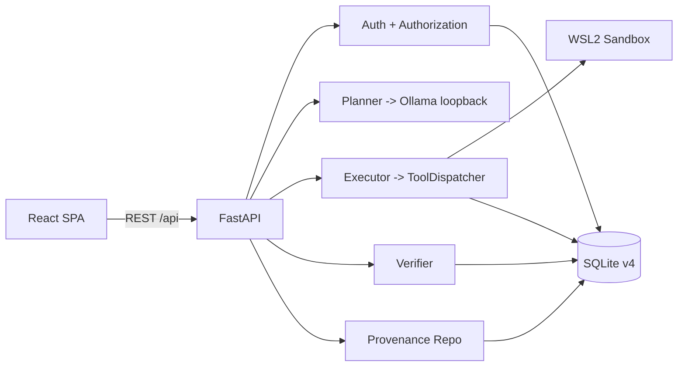

# ATLAS-X

A local-first research platform for studying **reliable, verifiable, secure multi-step AI agents**.

> Research question: *How do explicit planning, deterministic verification, provenance tracking, controlled tool execution, and bounded recovery affect the reliability and auditability of local multi-step AI agents?*

## Status

ATLAS-X is an implemented research prototype (version 0.1.0), not a deployed product. Core backend, HTTP API, React frontend, planning, execution, verification, recovery, sandboxing, and provenance are implemented. Containerization, dependency-aware readiness, hosted model endpoints, and a full WCAG audit are not.

No benchmark results are claimed. Any future metric must trace to a stored, reproducible run.

## What ATLAS-X does

ATLAS-X takes a user task, plans it with a local LLM, validates the plan deterministically, executes whitelisted tools inside a WSL2 sandbox, verifies results independently, records provenance, and supports bounded recovery. It is designed to measure how authorization, sandboxing, verification, provenance, and recovery affect agent reliability and security, with explicit ablation dimensions.

## Key capabilities (implemented and verified)

- Configuration with bounded, fail-closed settings (`atlas/config/settings.py`).
- SQLite persistence with WAL, foreign keys, and versioned schema v4 (`atlas/storage/`).
- Authentication with Argon2id passwords, opaque session tokens (SHA-256 stored), lockout, and generic errors (`atlas/auth/`).
- Authorization with a deny-by-default `AuthorizationService` and ownership checks (`atlas/security/`).
- Planner using Ollama-backed structured plan generation plus deterministic validation (`atlas/planner/`).
- Executor with validated plan execution and budgets (`atlas/executor/`).
- Tool registry and dispatcher with authorization and provenance (`atlas/tools/`).
- WSL2 sandbox for tool execution, with no in-process fallback (`atlas/sandbox/`).
- Independent verifier producing PASS/FAIL (`atlas/verifier/`).
- Failure classification and bounded recovery (`atlas/failure/`, `atlas/recovery/`).
- Artifact management with checksums (`atlas/artifact/`).
- Provenance events with chain digests and a verification endpoint (`atlas/storage/repositories.py`).
- FastAPI HTTP API with CORS, health, and readiness endpoints (`api/`).
- React + TypeScript + Vite frontend with protected routes (`frontend/src/`).

Partial or experimental:
- Benchmark and experiment scaffolding under `benchmarks/`, `experiments/`, and `datasets/`; no published results.
- JSONL logging is not used; provenance is stored in SQLite.

Not supported:
- Containerization or Docker runtime.
- Hosted model endpoint (local Ollama only).
- Multi-factor authentication or account recovery.
- Full WCAG 2.2 AA audit.
- License selected (MIT). Copyright holder name in `LICENSE` must be finalized before publication.

## Architecture



See `docs/architecture/SYSTEM_WORKFLOWS.md` for end-to-end flows and `docs/architecture/ARCHITECTURE_AND_TRADEOFFS.md` for decisions and trade-offs.

## Technology stack

| Technology | Role | Where used |
|---|---|---|
| Python 3.11 | Backend language | `atlas/`, `api/`, `tests/` |
| FastAPI | HTTP API | `api/__init__.py`, routers |
| Uvicorn | ASGI server | `api/server.py` |
| Pydantic | Validation and settings | `atlas/config/settings.py`, routers |
| Argon2 (argon2-cffi) | Password hashing | `atlas/auth/password.py` |
| SQLite 3.38+ | Persistence | `atlas/storage/`, `data/` |
| React 18 | Frontend UI | `frontend/src/` |
| TypeScript 5.6 | Frontend typing | `frontend/src/`, `frontend/tsconfig*.json` |
| Vite 5.4 | Frontend build/dev | `frontend/vite.config.ts` |
| Ollama (local) | LLM planning | `atlas/planner/model.py` |
| WSL2 (Windows) | Sandbox isolation | `atlas/sandbox/` |
| pytest 8+ | Backend tests | `tests/` |
| Ruff 0.4+ | Linting | `pyproject.toml` |
| mypy 1.10+ | Type checking | `pyproject.toml` |
| ESLint 9 | Frontend linting | `frontend/eslint.config.js` |
| Playwright 1.64 | E2E tests | `frontend/playwright.config.ts`, `frontend/tests/` |
## Execution lifecycle (example task)

1. User submits a task via the frontend (`frontend/src/pages/CreateTask.tsx`).
2. Frontend calls `POST /api/tasks` (`api/routers/tasks.py`).
3. Backend persists the task (`atlas/storage/repositories.py` `TaskRepo`).
4. User triggers planning; backend calls the local Ollama model (`atlas/planner/service.py`, `atlas/planner/model.py`).
5. Planner output is validated deterministically (`atlas/planner/validator.py`).
6. Executor runs validated plan steps, invoking whitelisted tools through the dispatcher (`atlas/executor/service.py`, `atlas/tools/dispatch.py`).
7. Each tool invocation is authorized (`atlas/security/service.py`) and executed in the WSL2 sandbox (`atlas/sandbox/supervisor.py`).
8. Results and artifacts are persisted (`atlas/storage/execution_repo.py`, `atlas/artifact/`).
9. Verifier independently checks results (`atlas/verifier/service.py`).
10. Provenance events with chain digests are recorded (`atlas/storage/repositories.py` `ProvenanceRepo`).
11. Frontend retrieves task detail, results, and provenance (`frontend/src/pages/TaskDetail.tsx`, `SecurityCenter.tsx`).

Model output is treated as untrusted input: plans are validated before execution, tool arguments are schema-validated, and results are independently verified.

## Repository structure

```
ATLAS-X/
├── .github/workflows/ci.yml   # CI: ruff, mypy, pytest, eslint, build, playwright
├── .env.example               # Safe environment template
├── .gitattributes             # Line-ending normalization
├── .gitignore                 # Excludes local/generated files
├── api/                       # FastAPI application and routers
│   ├── __init__.py            # App factory, CORS, security headers, startup
│   ├── server.py              # Uvicorn entry point
│   └── routers/               # auth, tasks, tools, system, benchmarks
├── atlas/                     # Core Python implementation
│   ├── artifact/              # Artifact management
│   ├── auth/                  # Authentication (Argon2, sessions, lockout)
│   ├── config/                # Bounded, fail-closed settings
│   ├── executor/              # Plan execution
│   ├── failure/               # Failure classification
│   ├── planner/               # LLM planning + deterministic validation
│   ├── provenance/            # Provenance helpers
│   ├── recovery/              # Bounded recovery
│   ├── sandbox/               # WSL2 sandbox (guest + supervisor)
│   ├── security/              # Authorization, identity, policy, logging
│   ├── storage/               # SQLite DB, migrations, repositories
│   ├── tools/                 # Tool registry, dispatcher, 6 built-in tools
│   ├── verifier/              # Independent verification
│   ├── cli.py                 # CLI health/smoke check
│   ├── logging_config.py      # Logging with secret redaction
│   └── util.py
├── benchmarks/                # Benchmark definitions (no published results)
├── datasets/                  # Dataset definitions
├── docker/                    # Docker documentation (no container build)
├── docs/                      # Architecture, security, audits, development
├── experiments/               # Experiment configurations
├── frontend/                  # React + TypeScript + Vite application
│   ├── src/                   # Application source
│   ├── tests/                 # Playwright E2E tests
│   ├── package.json           # Frontend dependencies and scripts
│   └── playwright.config.ts   # Playwright configuration
├── reports/                   # Intentional reports
├── scripts/                   # Helper scripts
├── tests/                     # Backend pytest suite
├── CONTRIBUTING.md
├── LICENSE                    # Placeholder (pending owner approval)
├── README.md
├── SECURITY.md
├── pyproject.toml             # Python project and tool configuration
├── run_backend.ps1
├── start_atlas.bat / .ps1
├── start_backend.bat
└── test_backend.ps1
```

Generated/local-only directories (excluded by `.gitignore`): `.venv/`, `node_modules/`, `frontend/dist/`, `data/`, `*.db`, caches, logs, Playwright reports/results, `.trae/`.

## Prerequisites

- Python 3.11+
- Node.js 20+
- SQLite 3 (included with Python)
- Optional: Ollama (for AI planning), WSL2 (for sandbox on Windows)

## Installation

```bash
# 1. Clone and enter repository
cd ATLAS-X

# 2. Create and activate virtual environment
python -m venv .venv
.venv\Scripts\Activate.ps1   # Windows PowerShell
# source .venv/bin/activate  # Linux/macOS

# 3. Install Python dependencies
pip install -e ".[dev]"

# 4. Install frontend dependencies
cd frontend
npm install
cd ..
```

## Environment configuration

Copy `.env.example` to `.env` and adjust:

```bash
ATLAS_ENVIRONMENT=development
ATLAS_DATABASE_PATH=data/atlas.db
ATLAS_APPLICATION_SECRET_KEY=   # required in production
ATLAS_MODEL_BASE_URL=http://127.0.0.1:11434
ATLAS_MODEL_NAME=llama3.1:8b
CORS_ALLOWED_ORIGINS=http://localhost:5173,http://127.0.0.1:5173
```

Frontend: copy `frontend/.env.example` to `frontend/.env` (leave `VITE_API_BASE_URL` empty when served by backend).
## Running the application

Backend (Terminal 1):
```bash
python -m uvicorn api:app --host 127.0.0.1 --port 8000
```

Frontend (Terminal 2):
```bash
cd frontend
npm run dev
```

- Frontend: http://localhost:5173
- Backend API: http://127.0.0.1:8000
- API docs (Swagger): http://127.0.0.1:8000/docs
- Health: http://127.0.0.1:8000/health
- Readiness: http://127.0.0.1:8000/ready

## Local model setup (optional, for planning)

```bash
# Install Ollama (https://ollama.com), then:
ollama pull llama3.1:8b
ollama serve
```

Without Ollama, planning is unavailable but other features work. The model endpoint is loopback-only by design.

## Sandbox requirements

Tool execution requires WSL2 on Windows (Ubuntu-24.04 distribution). Without WSL2, tool calls fail rather than running in-process. This is intentional: there is no unrestricted host fallback.

## Testing and verification

Backend:
```bash
python -m pytest -q --ignore=tests/test_planner_live.py
python -m ruff check .
python -m mypy atlas
```

Frontend (from `frontend/`):
```bash
npm run lint
npm run build
npx playwright test
```

Live planner tests (requires Ollama):
```bash
python -m pytest tests/test_planner_live.py
```

Current verified results: 737 backend tests passed, Ruff clean, mypy clean (94 files), ESLint clean, production build succeeded, Playwright 21/21 passed.

## Research and benchmark reproducibility

Benchmark and experiment infrastructure exists under `benchmarks/`, `experiments/`, and `datasets/`. The frontend includes a Benchmarks page and backend benchmark endpoints exist in `api/routers/benchmarks.py`.

Status: experimental. No benchmark results are claimed. The acceptance tests check page loading and control visibility only. Some security properties in `benchmarks/atlas_bench/runner/atlas_integration.py` are derived from scenario IDs, baseline harness flags, and task status rather than independently observed attack outcomes. `BaselineConfiguration.BASELINE_0` is explicitly simulated. Ablation modes use controlled harness doubles.

See `docs/ATLAS_BENCH.md`, `docs/EXPERIMENT_PROTOCOL.md`, `docs/METRICS.md`, and `docs/REPRODUCIBILITY.md`. Record measured results under `reports/` or `experiments/output/`; do not fabricate results.

## Security model and threat assumptions

- Password storage: Argon2id via `argon2-cffi`. Plaintext passwords never stored or logged.
- Sessions: opaque tokens (`secrets.token_urlsafe(32)`); only SHA-256 digest stored in SQLite.
- Expiry: explicit `expires_at`; expired sessions purged lazily.
- Rate limiting/lockout: per-account consecutive-failure tracking with temporary lockout; constant delay on failed auth; successful login resets counter.
- Error behavior: single generic error regardless of whether account exists.
- Authorization: deny-by-default `AuthorizationService`; ownership is the only grant; no roles or elevation path.
- Sandbox: WSL2 guest, no in-process fallback; output re-validated on host.
- Secrets redaction: `SecretsRedactionFilter` attached to root logger at startup.

Non-guarantees (see `SECURITY.md`):
- No protection against compromised host or local admin.
- No DDoS-grade rate limiting (in-process, resets on restart).
- No MFA or account recovery.
- No CSRF protection (no browser cookie auth yet; Bearer token in localStorage).
- Frontend stores auth token in `localStorage` (XSS exposure).
- Provenance digests are not signatures.
- WSL2/subprocess is not container-grade isolation.

## Known limitations and non-goals

- Containerization is not implemented.
- Readiness checks the database only; dependency-aware readiness is partial.
- Only local model endpoints are supported.
- Full WCAG/multi-viewport visual audit is pending.
- License is pending (`LICENSE` is a placeholder).
- Lockout is in-process and resets on restart.
- No MFA or account recovery.
- `SecretsRedactionFilter` covers configured secret values only.

## Deployment compatibility

ATLAS-X requires Python 3.11, Node 20 (build-time), SQLite persistence, local Ollama (optional), and WSL2 (for sandbox).

| Target | Feasible? | Notes |
|---|---|---|
| Local demo (Windows + WSL2 + Ollama) | Yes | Full capability. |
| Single-host self-managed (Windows + WSL2 + Ollama) | Yes | Full capability; owner manages backups. |
| Conventional managed cloud (no WSL2/Ollama) | Reduced only | Planner/sandbox unavailable; do not claim full execution. |

Containerization is not recommended for the full sandbox path. See `docs/DEPLOYMENT_GUIDE.md`.

## Contributing

Install into a venv, then run `python -m pytest`, `ruff check .`, and `mypy atlas` before proposing changes. Scope reads and writes to the project directory. Never commit secrets, `.env`, databases, or generated artifacts. Benchmark claims must be reproducible and recorded under `reports/` or `experiments/output/`.

See `CONTRIBUTING.md`.

## License

This project is licensed under the MIT License. See `LICENSE` for the full text.

Note: third-party dependencies and model weights (e.g., Meta Llama 3.1) retain their own licenses. "Freely downloadable" does not imply "OSI-approved open source." Replace `[Your Name]` in `LICENSE` with the copyright holder's legal name before publication.

## Acknowledgements

ATLAS-X builds on FastAPI, Pydantic, Argon2, React, Vite, Playwright, pytest, Ruff, and mypy. Model weights (e.g., Meta Llama 3.1) are licensed separately and are not OSI-approved open source. Dependency and model-weight licenses apply regardless of ATLAS-X's own license status.
