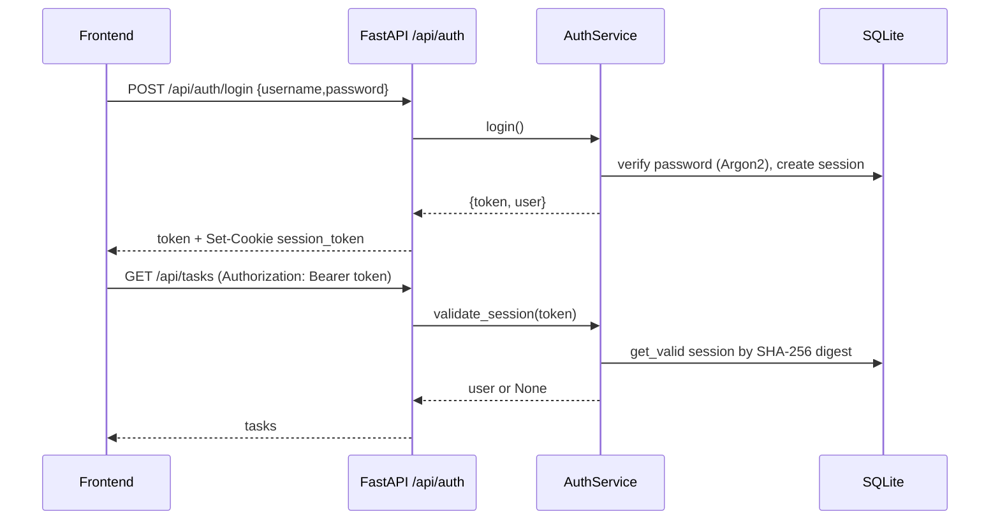
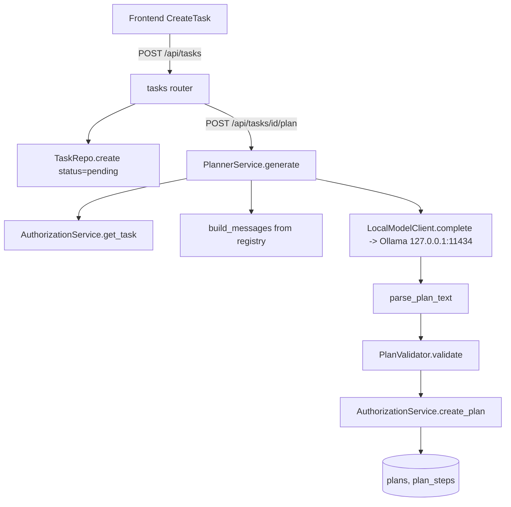
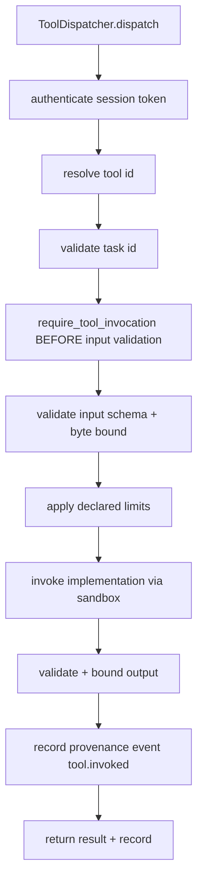
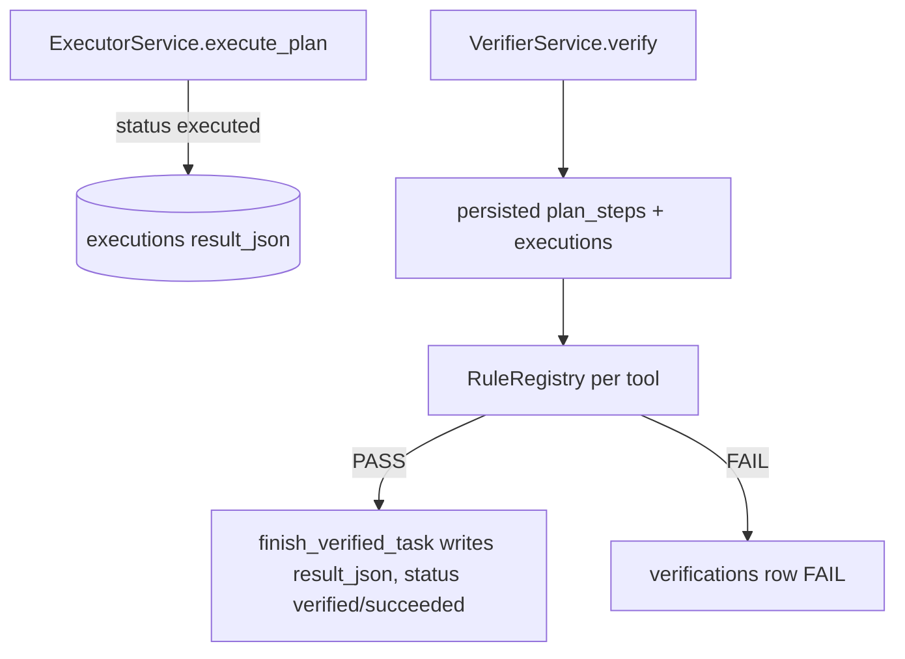
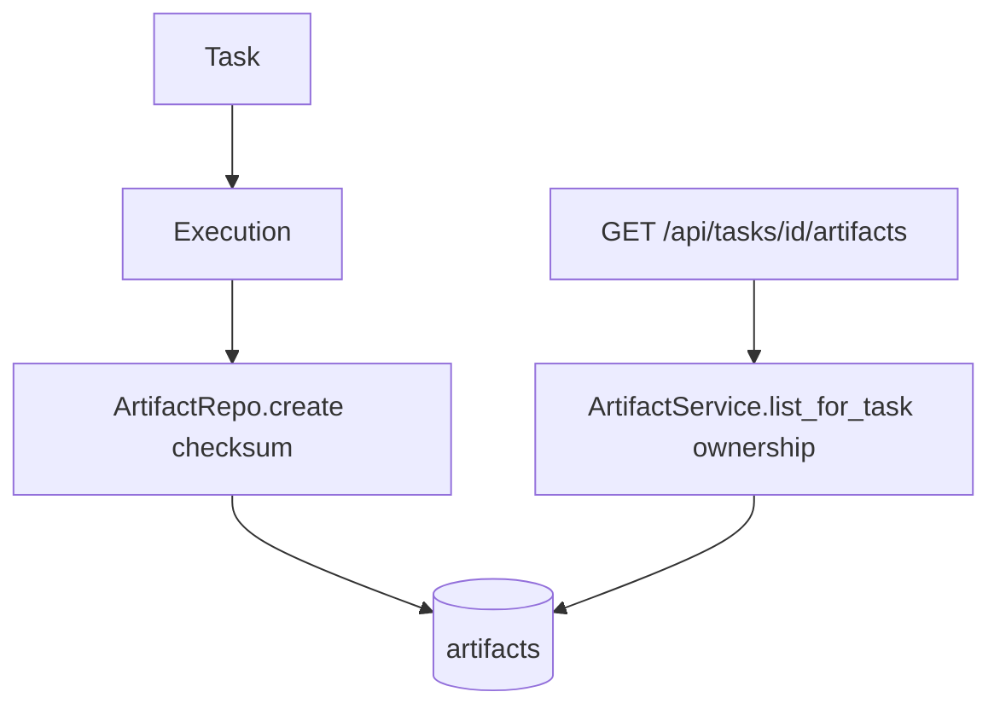

# System Workflows

This document traces real end-to-end control flows in ATLAS-X. Diagrams describe
actual code paths; trust boundaries and persistence points are marked.

## 1. Application startup and readiness

```mermaid
flowchart TD
  A[Operator runs atlas-x or uvicorn] --> B[Settings.from_environ]
  B --> C[Database.initialize]
  C --> D[upgrade_to_v3/v4 + init_db schema v4]
  D --> E[AuthService.bootstrap]
  E --> F[FastAPI app ready]
  F --> G[/health returns healthy]
  F --> H[/ready checks DB SELECT 1]
```

Evidence: `atlas/cli.py`, `api/server.py`, `api/__init__.py` (`/health`, `/ready`).

## 2. Login and authenticated request



Trust boundary: token is opaque; only its SHA-256 digest is stored. Frontend
stores the raw token in `localStorage` (security limitation).

## 3. Create task -> plan generation



## 4. Planning -> user authorization (tool grants)

Tool grants are resolved by `DatabaseToolGrantSource` in the tasks/tools routers:
default read-only analysis tools are granted to every authenticated user; extra
grants come from the `tool_permissions` table. `AuthorizationService.decide_tool_invocation`
and `require_tool_invocation` are the gate. A plan's existence is not permission.

## 5. Authorized tool execution



Sandbox: `SandboxSupervisor` runs the body in WSL2 guest; no in-process fallback.

## 6. Result capture and independent verification



Verifier trusts only persisted inputs/results/status; does not trust planner or
task status.

## 7. Provenance creation and validation

Provenance events are appended in `provenance_events` (with `chain_digest`) by
dispatch, failure recording, and recovery. `ProvenanceRepo.verify_chain_for_task`
checks the chain; exposed via `POST /api/tasks/{task_id}/provenance/verify`.
Note: digests are not signatures; records are mutable by DB holders.

## 8. Artifact metadata retrieval



## 9. Error, timeout, and recovery paths

- Execution budget: `max_tool_calls`, `max_execution_seconds` checked before each
  step; `ExecutionBudgetExceeded` stops the run.
- Sandbox timeout: guest enforces wall clock; supervisor kills wsl.exe tree on
  backstop timeout.
- Failure recording: `FailureService.record_failure` classifies and persists a
  `failures` row + provenance event.
- Recovery: `RecoveryService.attempt_recovery` enforces `max_recovery_attempts`;
  may create a corrected plan and re-execute. Exhausted -> `recovery_exhausted`
  event.

## 10. Benchmark or experiment execution

Benchmark/experiment infrastructure is declared in `docs/ATLAS_BENCH.md` and
`experiments/`. The frontend has a Benchmarks page; backend benchmark endpoints
are not present in the API routers. Status: partially implemented/experimental.
No benchmark results are claimed by this audit.

## 11. Frontend-to-backend communication

Frontend `api.ts` uses `fetch` with Bearer token from `localStorage`. Dev: Vite
proxy `/api` -> 8000. Prod: FastAPI serves `frontend/dist` on same origin.

## 12. Data persistence and retrieval

SQLite v4 schema: users, sessions, tasks, plans, plan_steps, executions,
artifacts, verifications, failures, recovery_attempts, provenance_events,
tool_permissions, user_preferences, schema_migrations. Ownership via `user_id`
columns and application-level predicates (see `owned_resources.py`).

Trust boundaries: frontend (untrusted) -> API (authn/authz) -> services -> DB.
Model is untrusted output; planner validates. Tool bodies confined by sandbox.
DB is the audit store but mutable by process.

Evidence: `atlas/storage/migrations.py`, `api/routers/tasks.py`,
`atlas/executor/service.py`, `atlas/verifier/service.py`.
